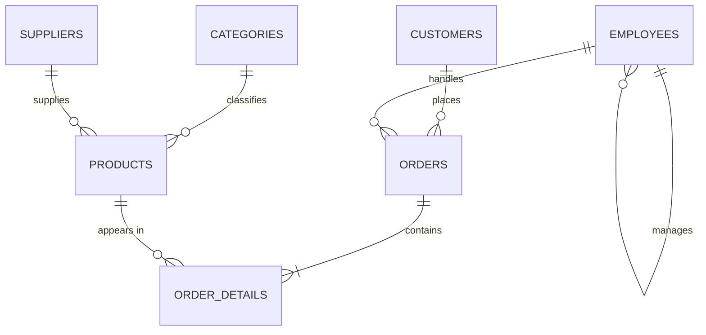
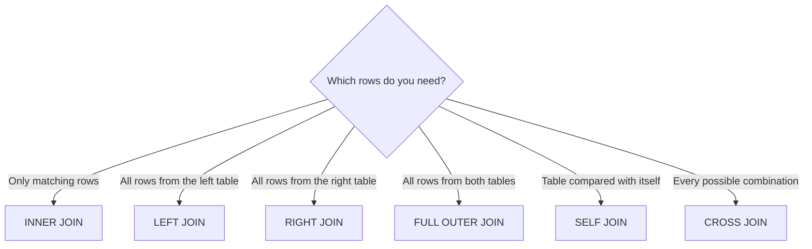
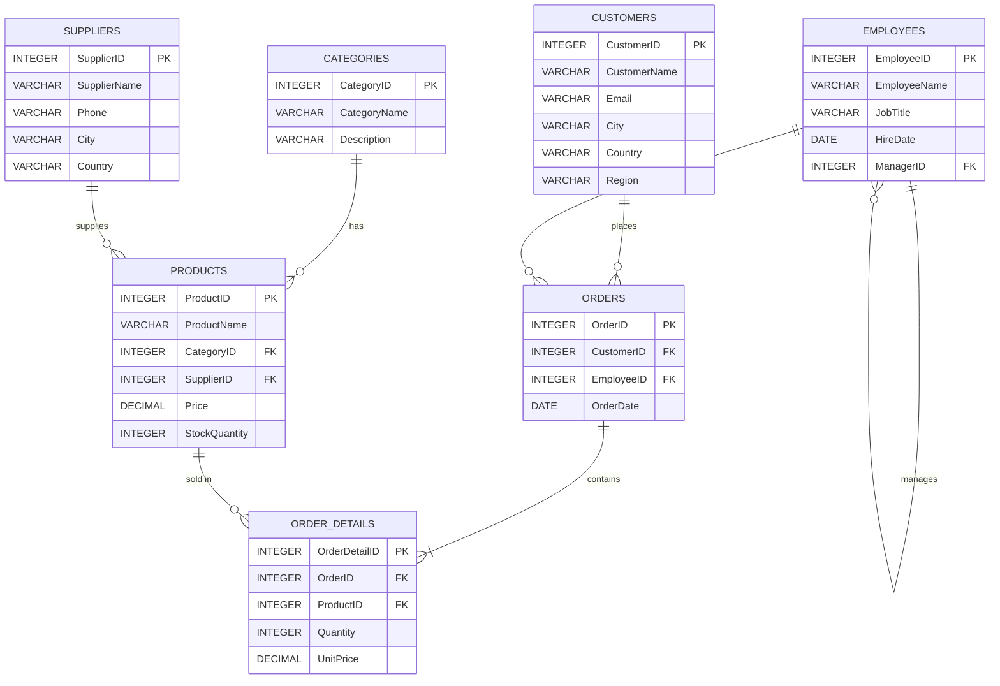
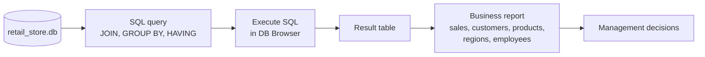
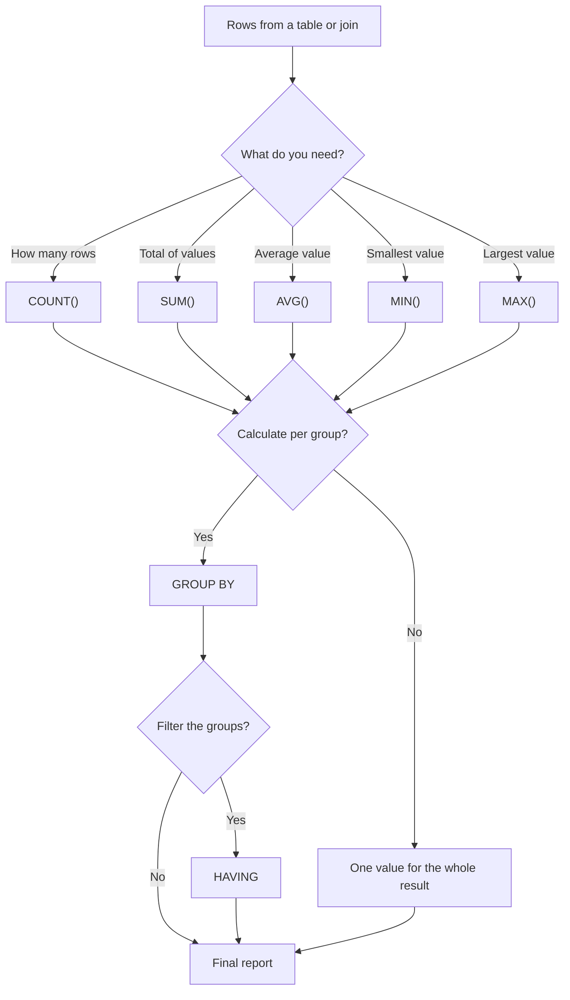
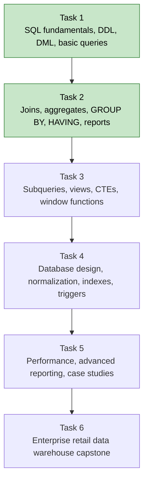

# Visuals (Task 2)

## 1. Relational Database ER Diagram

## 2. SQL Join Types Comparison

Which rows each join returns, where A is the left table and B is the right table:

| Join | Rows only in A | Matching rows | Rows only in B |
|---|---|---|---|
| INNER JOIN | No | Yes | No |
| LEFT JOIN | Yes | Yes | No |
| RIGHT JOIN | No | Yes | Yes |
| FULL OUTER JOIN | Yes | Yes | Yes |

| Join | Behaviour | Example in this project |
|---|---|---|
| SELF JOIN | A table joined to itself | Each employee with their manager |
| CROSS JOIN | Every row paired with every row | Every employee with every category |

Choosing a join:

## 3. Retail Database Schema Diagram

## 4. Business Reporting Workflow

## 5. Aggregate Function Flowchart

## 6. SQL Internship Progress Roadmap

Green tasks are complete.