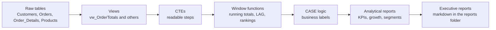
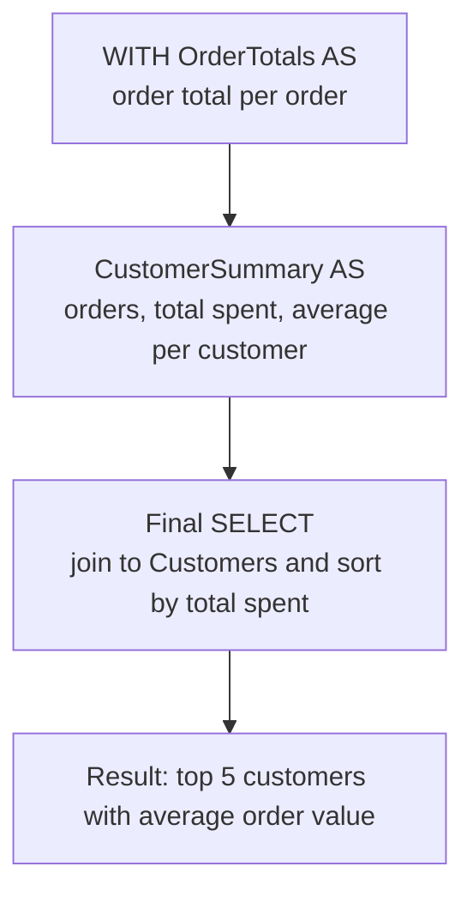
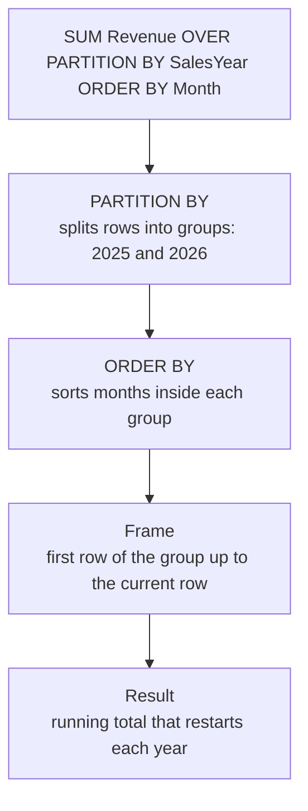
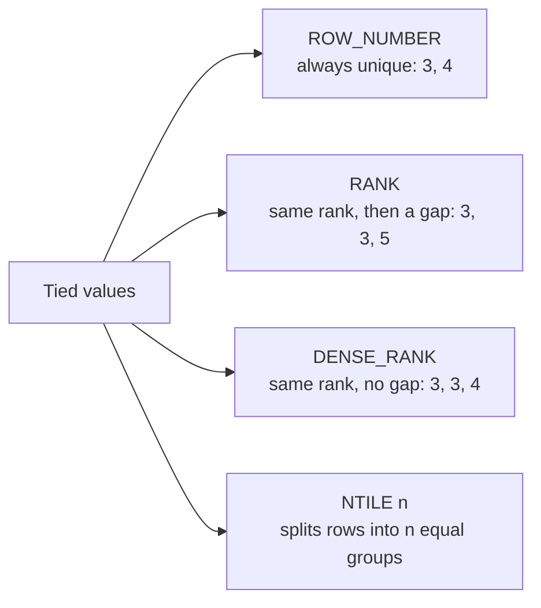
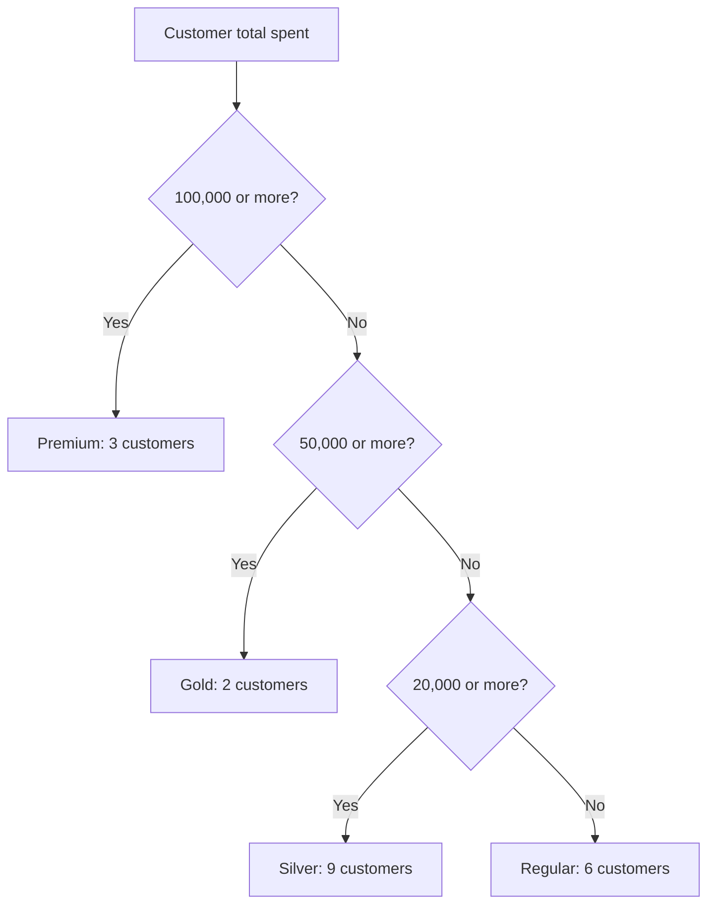
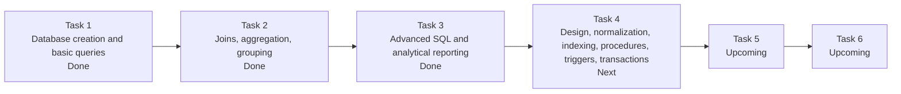

# Visuals

The diagrams below use Mermaid, which renders on GitHub. In VS Code they show only with a Mermaid preview extension.

## 1. Advanced SQL Query Workflow

## 2. CTE Execution Flow

The example is the average order value query (query 3 in `cte_queries.sql`).

Each CTE can use the ones defined before it. The CTEs exist only while the final statement runs.

## 3. Window Functions: OVER, PARTITION BY and ORDER BY

Result from `window_functions.sql` (query 6):

| Year | Month | Revenue | Year to date |
| --- | --- | ---: | ---: |
| 2025 | 2025-07 | 92,000 | 92,000 |
| 2025 | 2025-08 | 34,500 | 126,500 |
| 2025 | 2025-12 | 122,200 | 446,100 |
| 2026 | 2026-07 | 100,800 | 100,800 |
| 2026 | 2026-10 | 152,500 | 447,600 |

The total restarts at 100,800 when the partition changes from 2025 to 2026.

## 4. Ranking Functions Comparison

Customers ordered by number of orders (from `ranking.sql`, query 2):

| Customer | Orders | ROW_NUMBER | RANK | DENSE_RANK |
| --- | ---: | ---: | ---: | ---: |
| Rahul Sharma | 6 | 1 | 1 | 1 |
| Vikram Rao | 5 | 2 | 2 | 2 |
| Arjun Mehta | 4 | 3 | 3 | 3 |
| Priya Singh | 4 | 4 | 3 | 3 |
| Pooja Reddy | 3 | 5 | 5 | 4 |
| Rohit Verma | 3 | 6 | 5 | 4 |
| Amit Kumar | 2 | 7 | 7 | 5 |

NTILE(4) on customer spending gives five customers in each quartile. Quartile 1 holds everyone who spent 80,100 or more.

## 5. Customer Segmentation Flow Using CASE

The CASE expression is checked from top to bottom and the first match wins.

## 6. SQL Internship Progress Roadmap

